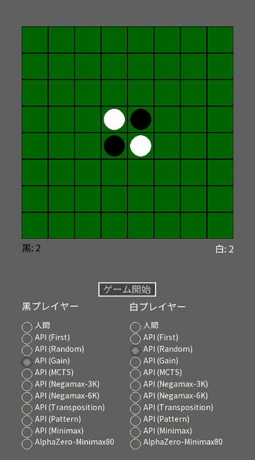
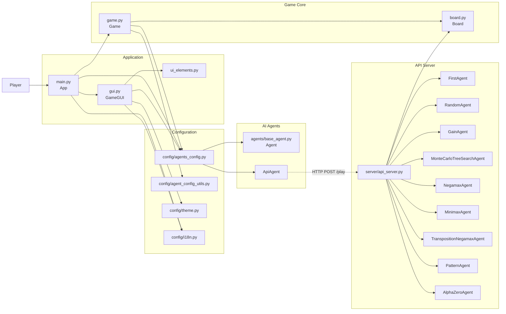
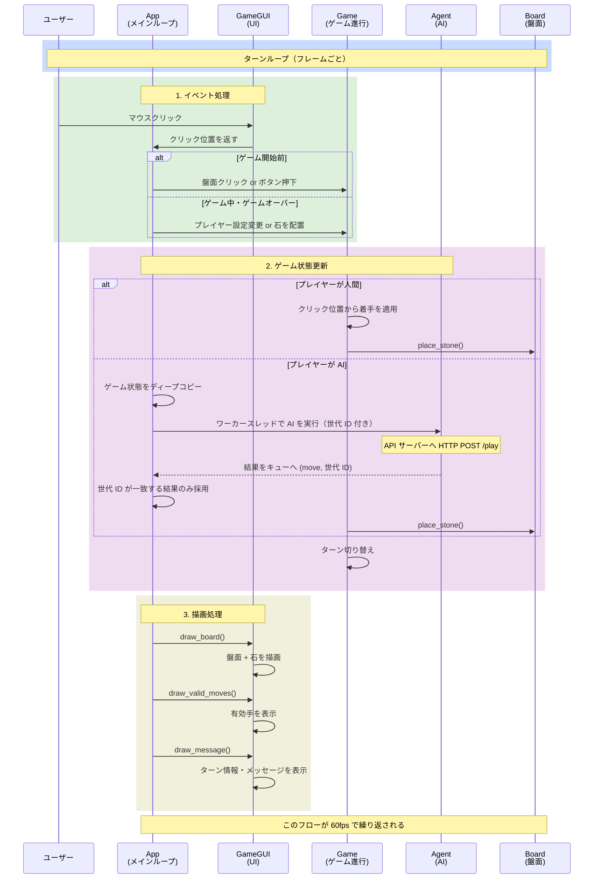

# Reversi (リバーシ) - Python / Pygame



## 概要

Python と Pygame で作られたリバーシゲームです。

- 人間 vs 人間、人間 vs AI、AI vs AI に対応
- **10 種類の AI 戦略**（First / Random / Gain / MCTS / Negamax-3K / Negamax-6K / Minimax / Transposition / Pattern / AlphaZero-Minimax80）を API サーバー経由で提供
- 「待った」（Undo）、リスタート、リセット、パス処理に対応
- 日本語 UI とフォント設定に対応
- プレイヤー設定欄はエージェントが増えて表示領域（最大 240px）を超えるとマウスホイールでスクロール可能（スクロールバー表示）
- **包括的なテスト体制**: 394 テスト（アプリ + サーバー + 統合 + 強さ検証）、カバレッジ 90%+（Tier 1）/ 100%（単体テスト）
- **AI 強さ検証**: Tier 1（8x8 盤面での高速強さテスト、16 テスト） / Tier 2（詳細ベンチマーク）で複数 AI の強さを確認
- **GitHub Actions CI**: Lint / 型チェック / テスト / Strength テスト / カバレッジ / サーバーテスト

## AI エージェント

GUI の「プレイヤー設定」では、次の 11 種類（人間 + AI 10 種類）を選べます。
AI はすべて `server/api_server.py` の API サーバーから手を取得するため、AI を使う場合は API サーバーの起動が必要です（`./scripts/start_with_server.sh` を推奨）。

| 表示名 | `agent_type` | 実装クラス | 概要 |
| --- | --- | --- | --- |
| `人間` | — | — | 盤面をクリックして着手 |
| `API (First)` | `first` | `FirstAgent` | 最初に見つかった合法手を選ぶ |
| `API (Random)` | `random` | `RandomAgent` | 合法手からランダムに選ぶ |
| `API (Gain)` | `gain` | `GainAgent` | 獲得石数が最大の手を選ぶ |
| `API (MCTS)` | `mcts` | `MonteCarloTreeSearchAgent` | モンテカルロ木探索 |
| `API (Negamax-3K)` | `negamax_3k` | `NegamaxAgent` | αβ枝刈り + 反復深化 + 終盤読み切り（位置重み・着手可能数・確定石で評価、3000ms） |
| `API (Negamax-6K)` | `negamax_6k` | `NegamaxAgent` | 同上（6000ms） |
| `API (Minimax)` | `minimax` | `MinimaxAgent` | 明示的 Max/Min 実装の αβ枝刈り + 反復深化 + 終盤 12 空き読み切り（既定 500ms） |
| `API (Transposition)` | `transposition` | `TranspositionNegamaxAgent` | αβ枝刈り + トランスポジションテーブル + PVS + Killer move（同時間で 2-3 倍深く探索、既定 3000ms） |
| `API (Pattern)` | `pattern` | `PatternAgent` | αβ枝刈り + Edax 式パターン評価（エッジ・コーナー・対角線パターン、TD 学習済み、既定 3000ms） |
| `AlphaZero-Minimax80` | `alphazero_minimax` | `AlphaZeroAgent` | 純粋 `OthelloNNet` + `MCTS`（`n_simulations=200`, `endgame_empties=0`）。`MinimaxAgent(500ms)` に対し勝率 80% 超を達成したモデル（`models/alpha_zero_minimax80_best.pth`） |

- AlphaZero 系エージェントは `AlphaZero-Minimax80` の 1 種類に整理済みです（旧 N3K / N6K / Hybrid / Solver などは削除）。
- API では GUI に出していない `negamax`（思考時間を `NEGAMAX_TIME_LIMIT_MS` で指定、既定 3000ms）も利用できます。
- エージェント定義は `config/agents_config.py` の `AGENT_DEFINITIONS` にあります。ID は保存済み設定との互換のため欠番があります。

## 構成図



## 動作環境

- Python 3.14.2 以上
- Pygame

API サーバーを使う場合は、追加で以下が必要です。

- FastAPI
- Pydantic
- Uvicorn

## インストール

基本環境を入れる場合:

```bash
uv sync
```

API サーバーも使う場合:

```bash
uv sync --extra server
```

開発用ツールも含めて全部入れる場合:

```bash
uv sync --all-extras
```

## クイックスタート

最もシンプルな起動方法：

```bash
./scripts/start.sh
```

API サーバー付きで起動（API エージェント使用可能）:

```bash
./scripts/start_with_server.sh
```

停止用:

```bash
./scripts/stop_with_server.sh
```

API サーバーのみ再起動する場合:

```bash
./scripts/restart_server.sh
```

Docker で起動（VNC で操作）:

```bash
./scripts/docker_start.sh
```

## 実行方法

### Docker を使わない実行（ローカル環境）

#### 方法 1: アプリのみを起動（シンプル）

ゲーム本体をシンプルに起動します。AI エージェントはすべて API サーバー経由のため、この方法では人間 vs 人間のプレイのみが可能です（AI を選択した場合は接続エラーになり、1 秒間隔で再試行します）。

**スクリプトを使う場合:**

```bash
./scripts/start.sh
```

**手動で起動する場合:**

```bash
# uv がインストール済みの場合
uv run python main.py

# Python を直接使う場合
python main.py
```

#### 方法 2: API サーバーとアプリを一緒に起動（AI エージェント使用）

AI エージェント（`API (First)` / `API (Random)` / `API (Gain)` / `API (MCTS)` / `API (Negamax-3K)` / `API (Negamax-6K)` / `API (Minimax)` / `AlphaZero-Minimax80` 等）を使う場合、API サーバーとアプリを起動します。

**スクリプトを使う場合（推奨）:**

```bash
./scripts/start_with_server.sh
```

このスクリプトは以下を自動で行います：
- API サーバーをバックグラウンドで起動
- サーバーの起動確認
- アプリケーションを起動
- 終了時に API サーバーも自動停止

別ターミナルで `uv run python -m server.api_server` と `uv run python main.py` を
個別に起動している場合は、`./scripts/stop_with_server.sh` で両方を停止できます。
API サーバーだけを入れ直したい場合は `./scripts/restart_server.sh` を使ってください。

**手動で起動する場合:**

ターミナル 1（API サーバー）:

```bash
# 環境設定（オプション）
export API_HOST=127.0.0.1  # デフォルト: 127.0.0.1
export API_PORT=5001       # デフォルト: 5001

# サーバー起動
uv run python -m server.api_server
```

ターミナル 2（アプリケーション）:

```bash
uv run python main.py
```

起動ログで `Uvicorn running on http://127.0.0.1:5001` が表示されたら正常です。API ドキュメントは http://127.0.0.1:5001/docs で確認できます。

アプリの「プレイヤー設定」でプレイヤーを `API (...)` のいずれかに設定すると、サーバー経由で AI が着手します。

### Docker を使用した実行（コンテナ環境）

Docker を使うと、依存関係やシステム設定に関わらず、どの環境でも同じ状態で実行できます。VNC を使って GUI を操作できます。

#### Docker イメージのビルド

イメージを構築します（初回のみ）。

```bash
docker build -t reversi-py .
```

または、スクリプトを使う場合（イメージの存在確認も行う）:

```bash
./scripts/docker_start.sh
```

#### Docker コンテナの起動

**スクリプトを使う場合（推奨）:**

```bash
./scripts/docker_start.sh
```

スクリプトは以下を行います：
- イメージを構築（存在しない場合）
- 既存コンテナを停止・削除
- コンテナを起動
- ポート設定情報を表示

**手動で起動する場合:**

```bash
docker run -d \
    --name reversi-container \
    -p 5901:5901 \
    -p 5001:5001 \
    -e DISPLAY=:1 \
    reversi-py
```

- `-d`: バックグラウンド実行
- `-p 5901:5901`: VNC ポート（ホスト:コンテナ）
- `-p 5001:5001`: API サーバーポート
- `-e DISPLAY=:1`: X11 ディスプレイ設定

#### VNC での GUI 接続

1. **VNC クライアントを起動**
   - macOS: Finder > 移動 > サーバーへ接続 > `vnc://localhost:5901`
   - Windows: TightVNC、RealVNC など
   - Linux: `vncviewer localhost:5901`

2. **接続情報**
   - ホスト: `localhost` または `127.0.0.1`
   - ポート: `5901`
   - パスワード: `reversi`（Dockerfile で設定）

3. **GUI 操作**
   - VNC 接続後は、ローカル実行と同様にゲームをプレイできます
   - API サーバーも同時に起動されています

#### コンテナの停止・削除

**スクリプトを使う場合:**

```bash
./scripts/docker_stop.sh
```

**手動で停止する場合:**

```bash
# コンテナを停止
docker stop reversi-container

# コンテナを削除
docker rm reversi-container
```

**すべての reversi コンテナを削除する場合:**

```bash
docker ps -a | grep reversi | awk '{print $1}' | xargs docker rm -f
```

#### コンテナ内でのトラブルシューティング

**ログを確認:**

```bash
docker logs -f reversi-container
```

**コンテナにシェルでアクセス:**

```bash
docker exec -it reversi-container bash
```

**API サーバーが起動しているか確認:**

```bash
# コンテナ内から
curl http://localhost:5001/docs

# ホストマシンから
curl http://localhost:5001/docs
```

#### 環境変数のカスタマイズ

Docker 起動時に環境変数を指定できます：

```bash
docker run -d \
    --name reversi-container \
    -p 5901:5901 \
    -p 5001:5001 \
    -e API_HOST=0.0.0.0 \
    -e API_PORT=5001 \
    -e LOG_LEVEL=debug \
    reversi-py
```

## API サーバー

API サーバーを起動すると、`API (...)` エージェントが使えるようになります。

```bash
uv run python -m server.api_server
```

既定の設定は次のとおりです。

- ホスト: `127.0.0.1`
- ポート: `5001`
- ログレベル: `info`

必要に応じて、環境変数で変更できます。

- `API_HOST`
- `API_PORT`
- `LOG_LEVEL`
- `MINIMAX_TIME_LIMIT_MS`（`agent_type="minimax"` 時の思考時間上限 ms、既定 `500`）
- `ALPHAZERO_MINIMAX_N_SIMULATIONS`（`agent_type="alphazero_minimax"` 時の MCTS 探索回数、既定 `200`）
- `ALPHAZERO_MINIMAX_MODEL`（`agent_type="alphazero_minimax"` のモデルパス、既定 `models/alpha_zero_minimax80_best.pth`）

API ドキュメント:

- Swagger UI: `http://127.0.0.1:5001/docs`
- OpenAPI JSON: `http://127.0.0.1:5001/openapi.json`
- エンドポイント: `POST /play`

### POST /play のリクエスト仕様

```json
{
  "board": [[0, 0, ...], ...],
  "turn": -1,
  "agent_type": "mcts"
}
```

- `board`: 正方形の 2 次元配列（各セルは -1: 黒、0: 空、1: 白）。サイズは 4〜16（DoS 防止の上限あり）
- `turn`: 手番（-1: 黒、1: 白）
- `agent_type`: `first` / `random` / `gain` / `mcts` / `negamax` / `negamax_3k` / `negamax_6k` / `minimax` / `transposition` / `pattern` / `alphazero_minimax` のいずれか（省略時は `random`）

レスポンスは `{"move": [row, col]}`、合法手がない場合は `{"move": null}` です。

## 使い方

1. ゲームを起動します
   - シンプル実行: `./scripts/start.sh`
   - API サーバー付き: `./scripts/start_with_server.sh`
   - Docker 使用: `./scripts/docker_start.sh`

2. 画面の「ゲーム開始」ボタンを押します

3. 盤面の合法手をクリックして石を置きます

4. プレイヤー設定で以下を選べます
   - `人間`: 人間が手を指します
   - `API (First)`, `API (Random)`, `API (Gain)`, `API (MCTS)`, `API (Negamax-3K)`, `API (Negamax-6K)`, `API (Minimax)`, `API (Transposition)`, `API (Pattern)`: API サーバー経由の AI（サーバー起動が必要）
   - `AlphaZero-Minimax80`: 訓練済み AlphaZero モデル（`models/alpha_zero_minimax80_best.pth`）
   - 選択肢が表示領域に収まらない場合は、欄の上でマウスホイールを回すとスクロールできます

5. 「待った」ボタンで手を戻せます（AI 対戦時は自分が打つ直前の状態まで戻ります）

## テスト

### 単体テストを実行（通常実行）

統合テストと強さテストを除く単体テスト（サーバー単体テスト含む）を実行します。

```bash
uv run pytest --ignore=tests/integration -q
```

期待: `307 passed, 12 subtests passed` （strength マーカーテスト自動除外）

### サーバー単体テスト

API サーバーのバリデーションテストを実行します（FastAPI TestClient 使用）。

```bash
uv run pytest tests/server/ -v
```

期待: `23 passed` （FastAPI エンドポイント、リクエスト・レスポンスの検証）

### AI 強さ検証テスト

Negamax エージェントの強さを検証する 2 層テスト体制です。

#### Tier 1: 強さテスト（CI 組み込み、8x8 盤面）

複数の AI エージェントを 8x8 盤面で検証する 16 テスト。実際の対局を含むため、全件実行には 10 分以上かかります。

```bash
# 明示的に実行
uv run pytest -m strength tests/test_strength.py -v
```

**テスト内容:**
- **Negamax 対 GainAgent**: 先後入替で勝利確認（2 テスト）
- **Transposition**: 初期化・合法手を返すことの確認（2 テスト）
- **Pattern**: 初期化・evaluator の存在確認（1 テスト）
- **AlphaZero**: 初期化・合法手・学習済みモデル（`models/alpha_zero_minimax80_best.pth`）での動作確認（3 テスト）
- **Transposition 対 Negamax / 対 Pattern**: 先後入替で勝利確認（4 テスト）
- **PatternEvaluator 統合版 Negamax 対 GainAgent**: 先後入替で勝利確認（2 テスト）
- **AlphaZero-Minimax80 対 Transposition(500ms)**: `n_simulations=200` で先後入替の勝利確認（2 テスト）

**注記**:
- 通常の `uv run pytest` 実行では strength テストは自動除外されます（pytest マーカーで管理）
- CI で `pytest -m strength` を明示的に実行

#### Tier 2: 詳細ベンチマーク（ローカル検証）

Negamax の強さを詳細に検証するベンチマークスクリプト。複数の対戦相手と盤面サイズで評価できます。

```bash
# デフォルト: MCTS 対手、8x8 盤面、10 ゲーム（54 秒）
uv run python scripts/benchmark_agents.py

# GainAgent 対手で高速確認（5 ゲーム、30 秒以内）
uv run python scripts/benchmark_agents.py --opponent gain --games 5

# 詳細検証: MCTS の反復回数と思考時間を増やす
uv run python scripts/benchmark_agents.py --mcts-iterations 100 --time-limit-ms 1000 --games 5
```

受け入れ基準:
- `--opponent mcts` 時: 80% 以上の勝率
- `--opponent gain` / `--opponent random` 時: 60% 以上の勝率

### AlphaZero 訓練

#### 強さテスト

```bash
# Negamax・GainAgent に対する勝率を確認
uv run pytest -m strength -v
```

#### 対 Minimax 勝率 80% 超ハイブリッド訓練（純粋 NN + MCTS）

終盤探索ソルバーへのフォールバックを使わず（`endgame_empties=0`, `n_simulations=200`）、純粋な `OthelloNNet` + `MCTS` のみで `MinimaxAgent(500ms)` に対し勝率 80% 超を目指す 3 段階ハイブリッド訓練パイプラインを提供しています。

- **Stage 1A（大規模オフライン教師事前蒸留 + D4 8 対称拡張）**: 高速 64-bit ビットボード探索教師 `BitboardTeacherAgent` による自己対戦（序盤 12% 探索手）と対 `MinimaxAgent` 混合対局の 400 局 / 21,647 局面を事前学習（`data/bitboard_pretrain_400g.npz`）
- **Stage 1B（標的型 DAgger + `ReplayBuffer`）**: `MinimaxAgent(500ms)` との実戦対局から弱点局面を収集し、教師ラベルで集中的に補強
- **Stage 2（安定化自己対戦 RL）**: 事前蒸留データを保持したまま低温 MCTS 自己対戦で方策・価値ヘッドを洗練
- **Stage 3（真のペア開口 50 局公式認定）**: 同一 4-ply ランダム開口 × 先後入替による 50 局ペア評価（`sims=200`, `endgame_empties=0`）

```bash
# ハイブリッド訓練（最良重みは models/alpha_zero_minimax80_best.pth に保存）
uv run python scripts/train_alphazero_minimax.py \
  --opponent minimax --opponent-time-ms 500 \
  --eval-sims 200 --cert-games 50 --target 0.80 \
  --workers 8 --device auto \
  --best-model models/alpha_zero_minimax80_best.pth \
  --latest-model models/alpha_zero_minimax80_latest.pth \
  --log-file logs/train_alphazero_minimax_v3.log

# 単一プロセスによる独立評価（Minimax / Negamax 双方）
uv run python scripts/evaluate_vs_minimax.py \
  --model models/alpha_zero_minimax80_best.pth \
  --opponent both --time-limit-ms 500 --games 50 --sims 200 --seed 123 --target 0.80
```

学習済みモデル（`models/alpha_zero_minimax80_best.pth`、`n_simulations=200`, `endgame_empties=0`）の評価結果:

| 評価種別 | 対戦相手 (思考時間) | シード | 対局数 | 勝率 (W-D-L) | 平均石差 | 95% Wilson CI |
| --- | --- | --- | --- | --- | --- | --- |
| 公式認定（Stage 2） | `MinimaxAgent` (500ms) | `42` | 50 | **86.0%** (`43W-1D-6L`) | `+10.92` | `[73.8%, 93.0%]` |
| 別シード独立検証 | `MinimaxAgent` (500ms) | `123` | 50 | **84.0%** (`42W-0D-8L`) | `+10.44` | `[71.5%, 91.7%]` |
| 別シード独立検証 | `NegamaxAgent` (500ms) | `123` | 50 | **84.0%** (`42W-0D-8L`) | `+9.32` | `[71.5%, 91.7%]` |
| 対 `MinimaxAgent` 合算 | `MinimaxAgent` (500ms) | `42, 123` | 100 | **85.0%** (`85W-1D-14L`) | `+10.68` | — |

#### GUI での使用

GUI で「プレイヤー設定」から `AlphaZero-Minimax80`、`API (Minimax)` などを選択すると、API サーバー経由で学習済みモデルまたは探索 AI と対戦できます。

**注記:**
- 学習済みモデルが見つからない場合、自動的に未学習モデルで動作します
- AlphaZero の強さを向上させるには、訓練イテレーション数を増やすか、自己対戦データを増やす必要があります
- 現在の実装は教育的な目的を想定しており、本格的な訓練には GPU の利用が推奨されます

### 統合テスト

実際にサーバーを起動してエンドツーエンドテストを実行します。

```bash
uv run pytest tests/integration/ -v
```

期待: `9 passed` （API サーバーの実際の起動、ApiAgent との通信）

### ローカル CI チェック

ローカルで GitHub Actions 相当のすべてのチェックを実行します。

```bash
./scripts/ci_check.sh
```

個別に Lint と型チェックだけを実行する場合:

```bash
# Lint チェック（ソースおよび全ファイル）
uv run ruff check . --select=E,W,F --ignore=E501 --exclude=tests
uv run ruff check .

# 型チェック（.venv に mypy 導入済み）
uv run mypy . --ignore-missing-imports
```

実行内容:
1. Lint チェック (ruff)
2. 型チェック (mypy)
3. テスト実行 (pytest) — strength テストは自動除外
4. カバレッジ確認 (100%)
5. サーバー単体テスト (FastAPI TestClient)
6. 統合テスト (実サーバー起動)

## アーキテクチャ詳細

### クラス責務の分離

このプロジェクトは **単一責務原則（SRP）** に基づいて設計されています。

| クラス | ファイル | 責務 |
|--------|---------|------|
| **App** | main.py | メインループ、ゲーム状態管理、AI 実行管理、UI イベント処理（4 責務をセクション化で整理）|
| **GameGUI** | gui.py | レイアウト計算、UI 描画、入力処理（49 メソッドを 4 セクション化）|
| **Game** | game.py | ゲーム進行、ターン管理、プレイヤー管理、勝敗判定 |
| **Board** | board.py | 盤面データ、ルール実装（有効手判定、石の反転） |

### コード構成の工夫

各クラスは責務ごとに **セクションコメント** で整理されています：

- **App クラス** (main.py)
  - `# === イベント処理 ===`
  - `# === 状態管理 ===`
  - `# === クリック処理のディスパッチ ===`
  - `# === AI・パス処理 ===`
  - `# === 描画 ===`

- **GameGUI クラス** (gui.py)
  - `# === ヘルパー ===`
  - `# === レイアウト計算・初期化 ===`
  - `# === 描画 ===`
  - `# === 入力処理 ===`

セクション化により、メソッド検索効率が向上し、新規開発者が各責務を一目で理解できます。

### AI 非同期実行の安全機構

AI の思考は UI を固めないようワーカースレッドで実行されます。並行処理に伴う不整合を防ぐため、以下の機構を備えています。

- **世代 ID**: プレイヤー変更・リスタート・リセット・「待った」の際に世代をインクリメントし、古い世代の AI 結果は破棄します
- **状態スナップショット**: AI スレッドにはゲーム状態のディープコピーを渡し、メインスレッドの盤面操作と競合しないようにします
- **再試行バックオフ**: API サーバーに接続できないなど AI が手を返せない場合、1 秒待ってから再試行します（接続ストーム防止）

### 将来の最適化

- **App**: GameController と AIManager への分離を検討
- **GameGUI**: GameLayout クラスの抽出を検討

現在の実装は テスト容易性 と 保守性 のバランスを優先しています。

### ゲーム進行シーケンス

各ターンの処理フローを以下に示します。



## 主要ファイル

### アプリケーション

- `main.py`: エントリーポイント（`App`: メインループ、イベント処理、AI 実行管理）
- `game.py`: ゲーム進行、履歴（待った）、パス、勝敗判定
- `board.py`: 盤面ロジック（合法手判定、石の反転）
- `gui.py`: Pygame GUI（`GameGUI`: レイアウト計算、描画、入力処理、プレイヤー設定欄のスクロール）
- `ui_elements.py`: ボタン・ラベル・ラジオボタンなどの UI 部品
- `theme.json`: GUI テーマ設定
- `fonts/`: 日本語フォント
- `data/translations/`: UI 文言の翻訳（日本語 / 英語）

### 設定

- `config/agents_config.py`: エージェント定義（`AGENT_DEFINITIONS`）
- `config/agent_config_utils.py`: エージェント定義の取得ヘルパー
- `config/game_constants.py`: ゲーム定数
- `config/theme.py`: 色・画面レイアウト定数
- `config/i18n.py`: 多言語対応（翻訳の読み込み）

### AI エージェント

- `agents/base_agent.py`: Agent 基底クラス
- `agents/api_agent.py`: ApiAgent（API サーバーに着手を問い合わせる GUI 側エージェント）
- `agents/first_agent.py` / `agents/random_agent.py` / `agents/gain_agent.py`: シンプルな AI
- `agents/mcts_agent.py`: MonteCarloTreeSearchAgent（モンテカルロ木探索）
- `agents/negamax_agent.py`: NegamaxAgent（αβ枝刈り + 反復深化 + 終盤読み切り）
- `agents/minimax_agent.py`: MinimaxAgent（明示的 Max/Min αβ枝刈り + 反復深化 + 終盤 12 空き読み切り）
- `agents/transposition_negamax_agent.py`: TranspositionNegamaxAgent（TT + PVS + Killer）
- `agents/pattern_evaluator.py`: PatternEvaluator（Edax 式パターン評価）
- `agents/pattern_agent.py`: PatternAgent（パターン評価 + αβ）
- `agents/alpha_zero_agent.py`: AlphaZeroAgent（MCTS + NN、任意で終盤ソルバー委譲）
- `agents/alphazero/mcts.py`: AlphaZero 用 PUCT MCTS
- `agents/alphazero/encoding.py`: 盤面テンソル変換
- `agents/networks/othello_net.py`: OthelloNNet（8x8 AlphaZero 用 PyTorch ネットワーク）
- `agents/networks/reversi_net.py`: ReversiNet（PyTorch ResNet）

### 学習済みデータ

- `models/alpha_zero_minimax80_best.pth`: AlphaZero-Minimax80 の学習済みモデル（git 追跡する唯一のモデル）
- `data/pattern_weights_8x8.json`: PatternAgent の学習済み重み

### AlphaZero 訓練・評価モジュール

- `training/alphazero/bitboard_teacher.py`: 64-bit ビットボード探索教師 `BitboardTeacherAgent`（PVS + TT + Killer/History + 14 空き完全読み）
- `training/alphazero/augmentation.py`: 盤面・方策の D4 8 対称拡張
- `training/alphazero/replay_buffer.py`: ソース別管理付き FIFO `ReplayBuffer`
- `training/alphazero/evaluation.py`: 同一開口ペア対局評価・`evaluate_against_agent`・Wilson 信頼区間
- `training/alphazero/losses.py`: 損失関数（policy soft-target CE + value MSE）
- `training/alphazero/checkpoint.py`: チェックポイントの保存・読み込み
- `scripts/train_alphazero_minimax.py`: 対 Minimax 勝率 80% 超 3 段階ハイブリッド訓練スクリプト
- `scripts/evaluate_vs_minimax.py`: 学習済みモデルの単一プロセス独立評価 CLI

### サーバー

- `server/api_server.py`: FastAPI REST API サーバー（エンドポイント: POST /play）
- `postman/`: Postman コレクション・環境設定

### テストと CI

- `tests/`: テストコード（394 テスト = 378 単体テスト + 16 強さテスト）
  - `tests/agents/test_*.py`: エージェント単体テスト
  - `tests/training/test_*.py`: AlphaZero 訓練モジュールのテスト
  - `tests/config/test_*.py`: エージェント定義・多言語対応のテスト
  - `tests/server/test_api_server.py`: サーバーテスト（35 テスト）
  - `tests/integration/test_api_integration.py`: 統合テスト（9 テスト）
  - `tests/postman/`: Newman による API テスト
  - `tests/test_strength.py`: AI 強さ検証テスト（16 テスト、Tier 1、8x8 盤面、strength マーカー）
    - Negamax 対 Gain（2 テスト）
    - Transposition 初期化・動作（2 テスト）
    - Pattern 初期化（1 テスト）
    - AlphaZero 初期化・動作・学習済みモデル（3 テスト）
    - Transposition 対 Negamax / 対 Pattern（4 テスト）
    - PatternEvaluator 統合版 Negamax 対 Gain（2 テスト）
    - AlphaZero-Minimax80 対 Transposition（2 テスト）

### スクリプト

- `scripts/start.sh` / `scripts/start_with_server.sh` / `scripts/stop_with_server.sh` / `scripts/restart_server.sh`: ローカル起動・停止
- `scripts/docker_start.sh` / `scripts/docker_stop.sh`: Docker での起動・停止
- `scripts/check.sh` / `scripts/ci_check.sh`: ローカル CI チェック
- `scripts/check_coverage.py`: カバレッジ確認
- `scripts/test_gui_init.py`: GUI 初期化の統合テスト
- `scripts/run_postman_api_tests.sh`: Postman（Newman）API テスト
- `scripts/train_pattern_weights.py`: PatternAgent の重みを TD 学習で訓練
- `scripts/benchmark_agents.py`: ベンチマークスクリプト（Tier 2、複数オプション対応）
- `.github/workflows/ci.yml`: GitHub Actions 定義（Lint / Type / Test / Strength / Coverage）

## 補足

- 合法手がない場合は自動でパスします。
- ゲームの進行や AI の着手ログはコンソールにも出力されます。

## ライセンス

MIT License です。詳細は `LICENSE` を参照してください。
